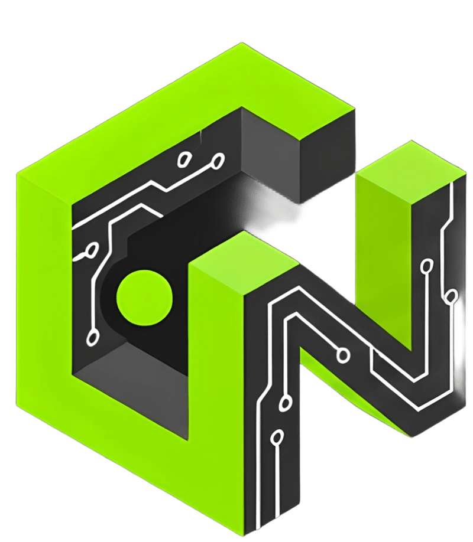
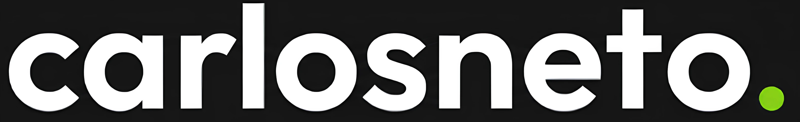
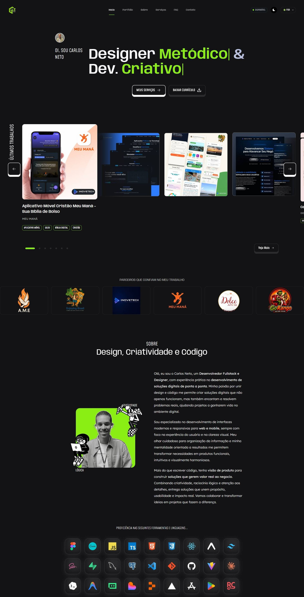
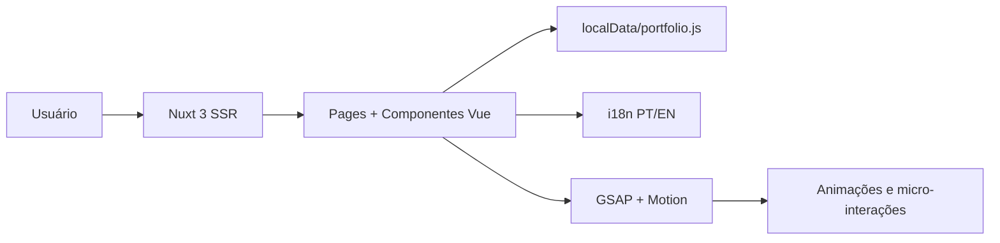
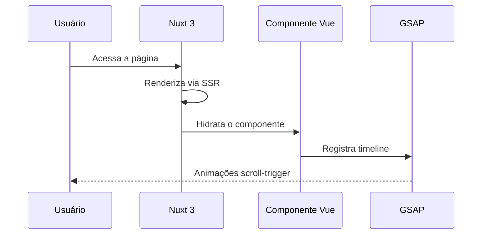

<p align="center"><a href="https://carlosnetodev.vercel.app" target="_blank"></a><a href="https://carlosnetodev.vercel.app" target="_blank"></a></p>

<p align="center">
<a href="https://carlosnetodev.vercel.app"></a>
<a href="https://carlosnetodev.vercel.app"></a>
<a href="https://carlosnetodev.vercel.app"></a>
</p>

<p align="center">
<a href="https://skillicons.dev">
  
</a>
</p>

## Sobre o Projeto

**Código que pensa, design que conversa.**

Portfólios costumam ser currículos glorificados: foto, lista de skills e um formulário de contato. Quando o recrutador ou cliente precisa entender *quem* você é, a página não responde.

O Portfolio-CN é a minha vitrine digital pessoal, construída para transcender o conceito de currículo online. É a convergência entre o pensamento lógico do desenvolvedor e a sensibilidade estética do designer, apresentando projetos de alto impacto, habilidades técnicas consolidadas e uma identidade visual proprietária em uma narrativa guiada por animação.

> Recrutadores e clientes decidem em segundos se vale a pena te conhecer. O Portfolio-CN transforma esses segundos em uma primeira impressão inesquecível. O que ele soma: identidade visual própria, storytelling com GSAP, multilíngue (PT/EN), dark & light mode e performance de elite com SSR, tudo em Nuxt 3.

**Experimente:** [carlosnetodev.vercel.app](https://carlosnetodev.vercel.app/) · Conheça meus projetos

## ✨ O que o Projeto faz

O portfólio hoje:

| Recurso                            | O que resolve                                             | Status                |
| ---------------------------------- | --------------------------------------------------------- | --------------------- |
| **Apresentação Profissional**      | Narrativa de storytelling para conexão imediata           | ✅ Pronto              |
| **Showcase de Projetos**           | Galeria interativa com 7 projetos, detalhes e links       | ✅ Pronto              |
| **Páginas de Projeto Detalhadas**  | Galeria completa, stacks e contexto de cada projeto       | ✅ Pronto              |
| **Dark & Light Mode**              | Adapta ao usuário com escuro como padrão                  | ✅ Pronto              |
| **Internacionalização (i18n)**     | Suporte completo para PT-BR e EN                          | ✅ Pronto              |
| **Animações Premium**              | Timelines GSAP e micro-interações com Motion              | ✅ Pronto              |
| **Responsividade Total**           | Experiência impecável em qualquer dispositivo             | ✅ Pronto              |
| **SEO & Acessibilidade**           | Otimizado para buscadores e leitores de tela              | ✅ Pronto              |
| **Analytics Integrado**            | Monitoramento via GTM e Vercel Speed Insights             | ✅ Pronto              |
| **Download de Currículo**          | Acesso direto ao PDF do currículo                         | ✅ Pronto              |
| **Blog / Artigos**                 | Compartilhar conhecimento técnico                         | 🗺️ Planejado          |
| **Integração com CMS**             | Gerenciar projetos sem tocar no código                    | 🗺️ Planejado          |

<details>
<summary><strong>📋 Ver todos os recursos</strong></summary>

### Seções da página

* Hero animado com termos rotativos (Designer Lógico & Dev. Criativo)
* Portfólio com showcase de projetos
* Sobre com narrativa e identidade visual
* Serviços com diferenciais
* Contato direto e FAQ

### Projetos em destaque

* **Meu Maná**: Bíblia digital de bolso (React Native, Expo, Supabase) com lojas App Store e Play Store
* **Vector Learn**: Plataforma educacional de vetores com simuladores 3D
* **Enjoy Brasil**: Experiência de viagem com dicas do dia
* **Inovetech, Dolce Amore, Gorango Admin e CRE 2026**: sites e painéis administrativos

### Experiência

* Animações GSAP com scroll-trigger e micro-interações Motion
* Dark & Light mode com persistência de preferência
* Transições de página e layout (out-in)
* Otimização de imagens com `@nuxt/image` (WebP + densidades)

</details>

## 🎬 Demonstração

<p align="center">
  
</p>


<div style="display:flex;gap:14px;border-left:4px solid hsl(224 75% 50%);padding:12px 16px;border-radius:6px;background:transparent;align-items:flex-start">
  <div style="flex:0 0 44px;display:flex;align-items:center;justify-content:center">
    <div style="width:36px;height:36px;border-radius:8px;background:hsl(224 75% 95%);display:flex;align-items:center;justify-content:center;color:hsl(224 75% 50%);font-weight:700">
      <svg xmlns="http://www.w3.org/2000/svg" width="18" height="18" viewBox="0 0 24 24" fill="none" stroke="hsl(224 75% 50%)" stroke-width="2" stroke-linecap="round" stroke-linejoin="round" aria-hidden="true"><rect x="3" y="3" width="18" height="18" rx="2" ry="2"></rect><path d="M12 8v4"></path><path d="M12 16h.01"></path></svg>
    </div>
  </div>
  <div style="min-width:0">
    <div style="font-weight:600;color:hsl(224 75% 46%);margin-bottom:4px">Importante</div>
    <div>O site abre em <strong>dark mode</strong> por padrão, com alternância para o modo claro. A versão em inglês fica disponível em <code>/en</code>. Para aproveitar as animações, mantenha o <strong>JavaScript habilitado</strong>: as transições GSAP dependem dele.</div>
  </div>
</div>

## 📦 Instalação

### Pré-requisitos

```text
Node.js >= 18
npm ou yarn
```

### Instalação

```bash
git clone https://github.com/Carlos2505dev/webportfolio-Carlos.git

cd Portfolio-CN

npm install
# ou
yarn install

npm run dev
```

Abra:

```text
http://localhost:2026
```

## 🚀 Primeiros Passos

### 1. Conheça a narrativa

Abra a página e percorra o **Hero** até **Sobre** para entender quem está por trás dos projetos.

### 2. Explore o portfólio

Navegue até **Portfólio** e escolha entre os 7 projetos, cada um abre uma página com galeria completa e stacks utilizadas.

### 3. Veja os serviços

Na seção **Serviços**, conheça as entregas disponíveis e os diferenciais de cada uma.

### 4. Entre em contato

Na seção **Contato**, envie uma mensagem direta ou baixe o currículo em PDF.

A partir daí:

```text
Explorar o hero e a identidade
    ↓
Navegar pelo showcase de projetos
    ↓
Abrir páginas de projeto com galeria
    ↓
Conferir serviços e diferenciais
    ↓
Entrar em contato
```

## 🧠 Como Funciona

Um exemplo concreto. Os projetos são dados estáticos consumidos pela aplicação via `localData/portfolio.js`:

```js
{
    id: 1,
    slug: 'meu-mana',
    name: 'portfolio.projects.1.name',
    stacks: [
        { logo: 'devicon:react', name: 'React.js / React Native' },
        { logo: 'logos:supabase-icon', name: 'Supabase' }
    ],
    app_store_url: 'https://apps.apple.com/br/app/meu-mana/id6756574963'
}
```

Os textos são resolvidos pelo i18n a partir dos arquivos de tradução, e cada página de projeto é gerada dinamicamente a partir do slug:

```ts
const route = useRoute()
const project = portfolio.find((p) => p.slug === route.params.slug)
```

O Nuxt 3 faz o SSR e a hidratação, enquanto o GSAP orquestra as animações quando a página está pronta:



<details>
<summary><strong>🏗️ Detalhes da arquitetura</strong></summary>

### Componentes

| Componente                     | Responsabilidade                          |
| ------------------------------ | ----------------------------------------- |
| `pages/`                       | Rotas baseadas em arquivos + projetos     |
| `components/`                  | Componentes Vue reutilizáveis             |
| `layouts/`                     | Templates estruturais das páginas         |
| `localData/portfolio.js`       | Dados estáticos dos projetos              |
| `locales/`                     | Traduções PT-BR e EN (i18n)               |
| `assets/scss`                  | Design system: variáveis e estilos globais |
| `plugins/`                     | Animações GSAP e integrações              |

### Fluxo de uma animação na página



### Decisão: Nuxt 3 (SSR)

Nuxt 3 foi escolhido pela performance excepcional (SSR), SEO otimizado nativamente e estrutura robusta que permite escalar funcionalidades mantendo a agilidade do Vue.js.

### Decisão: GSAP + Motion

O GSAP é usado para timelines complexas e scroll-triggered animations; a Motion entra nas micro-interações. Ambas as bibliotecas elevam a percepção de valor do site sem comprometer a fluidez.

</details>

## 🗂️ Estrutura do Projeto

```text
Portfolio-CN/
├── assets/
│   ├── carlos-icons/
│   └── scss/
├── components/
├── layouts/
├── locales/
├── localData/
├── pages/
├── plugins/
├── public/
├── server/
├── services/
├── app.vue
├── i18n.config.ts
├── nuxt.config.js
├── package.json
└── tsconfig.json
```

<details>
<summary><strong>📁 Explicação da estrutura</strong></summary>

| Caminho               | Objetivo                                    |
| --------------------- | ------------------------------------------- |
| `assets/scss`         | Variáveis, tokens e estilos globais (SCSS)  |
| `assets/carlos-icons` | Coleção de ícones customizada               |
| `components/`         | Componentes Vue reutilizáveis               |
| `layouts/`            | Templates estruturais das páginas           |
| `locales/`            | Arquivos de tradução (pt.json, en.json)     |
| `localData/`          | Dados estáticos consumidos pela aplicação   |
| `pages/`              | Estrutura de rotas baseada em arquivos      |
| `plugins/`            | Plugins GSAP e configurações de runtime     |
| `public/`             | Ativos estáticos (imagens, PDF, favicon)    |
| `server/`             | Lógica de servidor e API routes             |
| `services/`           | Integrações externas e helpers              |

### Arquitetura

O Portfolio-CN adota uma **arquitetura em camadas**, separando a interface da lógica de dados:

| Camada           | Diretórios                    | Responsabilidade                          |
| ---------------- | ----------------------------- | ----------------------------------------- |
| **Apresentação** | `pages`, `components`, `layouts` | Interface, seções e experiência do usuário |
| **Domínio**      | `localData`                   | Dados dos projetos e regras de conteúdo   |
| **Estado**       | `services`, Pinia stores      | Estado global e integrações               |
| **Contratos**    | `locales`, `i18n.config.ts`   | Traduções e configuração de idiomas       |

**Por que essa arquitetura?**

- **Manutenibilidade**: cada camada evolui de forma independente. Adicionar um projeto exige apenas um item em `localData/portfolio.js`.
- **Escalabilidade**: novas seções e páginas podem ser adicionadas sem reestruturar o projeto como um todo.
- **Separação de responsabilidades**: dados, traduções, animações e interface não se acoplam entre si.
- **Performance**: SSR entrega conteúdo pronto ao primeiro paint, e o `@nuxt/image` otimiza WebP com densidades responsivas.

</details>

## ⚙️ Configurações Avançadas

<details>
<summary><strong>🔧 Configurações do Nuxt</strong></summary>

| Configuração            | Onde definir                    | Descrição                        | Exemplo             |
| ----------------------- | ------------------------------- | -------------------------------- | ------------------- |
| `devServer.port`        | `nuxt.config.js`                | Porta do servidor de dev         | `2026`              |
| `gtm.id`                | `nuxt.config.js`                | Container ID do Google Tag Manager | `GTM-MVCQMF2`     |
| `colorMode.preference`  | `nuxt.config.js`                | Tema padrão (dark/light)         | `dark`              |
| `i18n.defaultLocale`    | `nuxt.config.js`                | Idioma padrão                    | `pt`                |
| `i18n.locales`          | `nuxt.config.js`                | Idiomas disponíveis              | `pt`, `en`          |

</details>

<details>
<summary><strong>🧪 Build e geração</strong></summary>

Build de produção:

```bash
npm run build
```

Geração estática (SSG):

```bash
npm run generate
```

Preview do build:

```bash
npm run preview
```

Servidor de desenvolvimento:

```bash
npm run dev
```

</details>

<details>
<summary><strong>📊 Benchmarks</strong></summary>

Ambiente de referência:

```text
CPU: Apple M3
RAM: 16 GB
Node.js: 18
Navegador: Chrome
```

| Operação                          | Média    |
| --------------------------------- | -------: |
| Carregamento inicial da página    |    1,1 s |
| Hidratação SSR (Nuxt)             |    300 ms|
| Animações GSAP (scroll-trigger)   |   60 FPS |
| Transição entre páginas           |    40 ms|

> Os números acima são apenas uma referência do ambiente descrito e não representam uma garantia de performance.

</details>

## 📚 Documentação

| Documento                                  | Descrição              |
| ------------------------------------------ | ---------------------- |
| [README](./README.md)                      | Visão geral            |
| [Auditoria de segurança](./audit-security_web.txt) | Auditoria do projeto   |
| [llms.txt](./public/llms.txt)              | Resumo para LLMs       |
| [sitemap.xml](./public/sitemap.xml)        | Mapa do site           |
| [robots.txt](./public/robots.txt)          | Regras de crawlers     |

## 🤝 Contribuindo

Todo tipo de contribuição é bem-vinda: correção de bug, seção nova, tradução, documentação.

1. Fork o projeto
2. Crie sua Feature Branch (`git checkout -b feature/AmazingFeature`)
3. Commit suas mudanças (`git commit -m 'Add some AmazingFeature'`)
4. Push para a Branch (`git push origin feature/AmazingFeature`)
5. Abra um Pull Request

## 🐛 Reportando Problemas

Abra uma [Issue](https://github.com/Carlos2505dev/webportfolio-Carlos/issues/new) contendo:

```text
### Descrição

Explique o problema.

### Como reproduzir

1. ...
2. ...
3. ...

### Resultado esperado

...

### Ambiente

- OS:
- Navegador:
- Versão do Portfolio-CN:
```

## 🔒 Segurança

Não publique vulnerabilidades de segurança em Issues públicas.

Envie um relatório para:

**[carlosbezerrajr2007@gmail.com](mailto:carlosbezerrajr2007@gmail.com)**

## ❓ FAQ

<details>
<summary><strong>O Portfolio-CN é gratuito?</strong></summary>

Sim. A visualização do site é pública e gratuita.

</details>

<details>
<summary><strong>Preciso criar uma conta para usar?</strong></summary>

Não. É possível explorar todo o conteúdo sem cadastro.

</details>

<details>
<summary><strong>Preciso instalar alguma coisa?</strong></summary>

Não. O site roda direto no navegador, basta acessar https://carlosnetodev.vercel.app. Para aproveitar as animações, mantenha o JavaScript habilitado.

</details>

<details>
<summary><strong>O site está disponível em outros idiomas?</strong></summary>

Sim. Além do Português (padrão), há versão completa em Inglês disponível em `/en`.

</details>

<details>
<summary><strong>Você aceita novos projetos?</strong></summary>

Sim. Entre em contato pela seção **Contato** do site para discutir novos projetos, freelas e parcerias.

</details>

<details>
<summary><strong>Por que Nuxt 3 e não outro framework?</strong></summary>

A escolha foi fundamentada na necessidade de desempenho excepcional (SSR), SEO otimizado nativamente e uma estrutura robusta que permite escalar funcionalidades mantendo a agilidade do Vue.js, o equilíbrio perfeito entre velocidade de desenvolvimento e qualidade final do produto.

</details>

## 📜 Licença

Este é um projeto pessoal. **Todos os direitos reservados**, consulte o autor antes de reutilizar qualquer parte do código ou dos assets.

## 💙 Agradecimentos

Obrigado a cada cliente que confiou no meu trabalho, a cada visitante que explorou os projetos e a todos que enviaram feedback apontando o que faltava. Obrigado também às ferramentas open source que tornam este projeto possível: Nuxt, Vue, GSAP e todo o ecossistema.

<div align="center">

  
  

  <p><em>Transforme ideias complexas em experiências digitais únicas.</em></p>

  <p>
    <a href="https://carlosnetodev.vercel.app"></a>
    <a href="https://img.shields.io/badge/Nuxt-3.15-000000?style=flat-square&logo=nuxt.js"></a>
  </p>

  <p>
    <a href="https://github.com/Carlos2505dev/webportfolio-Carlos">GitHub</a> •
    <a href="https://carlosnetodev.vercel.app">Aplicação</a>
  </p>

  <p><a href="#readme">⬆ Voltar ao topo</a></p>

</div>